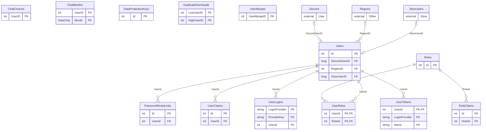
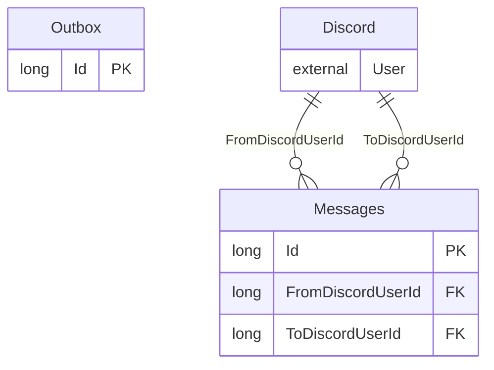
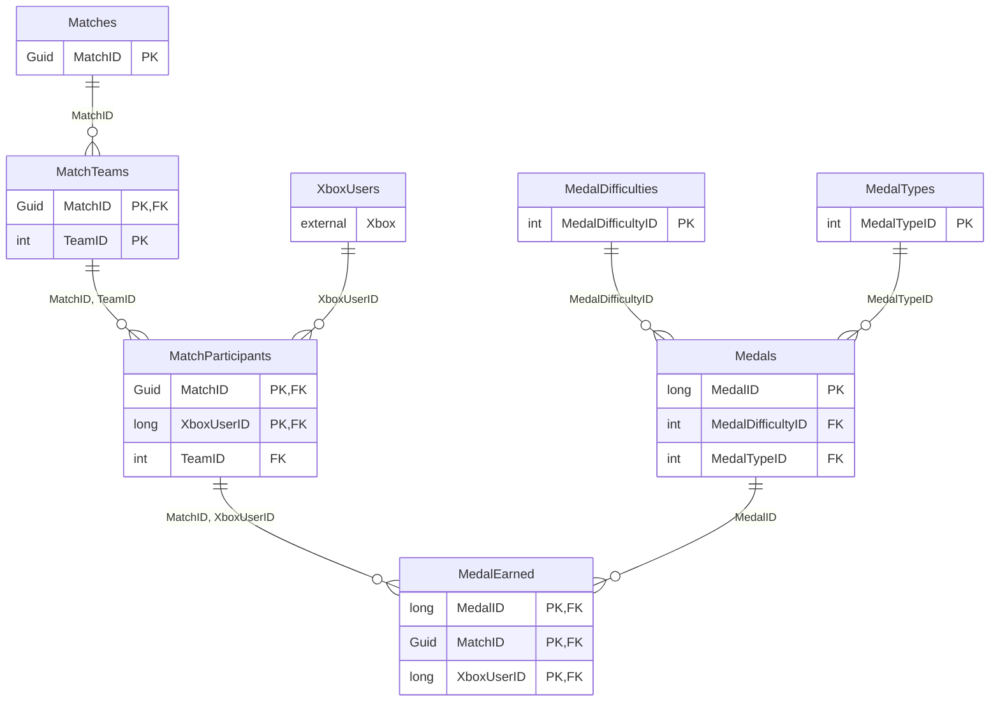
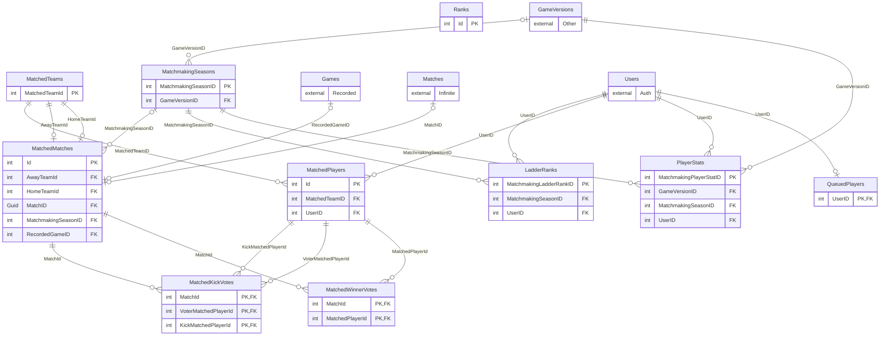
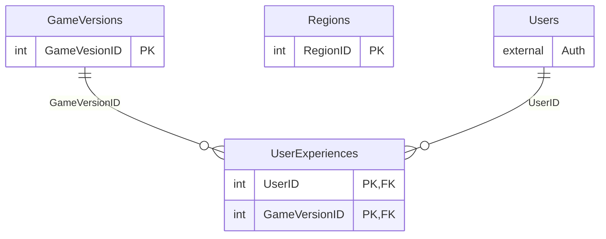
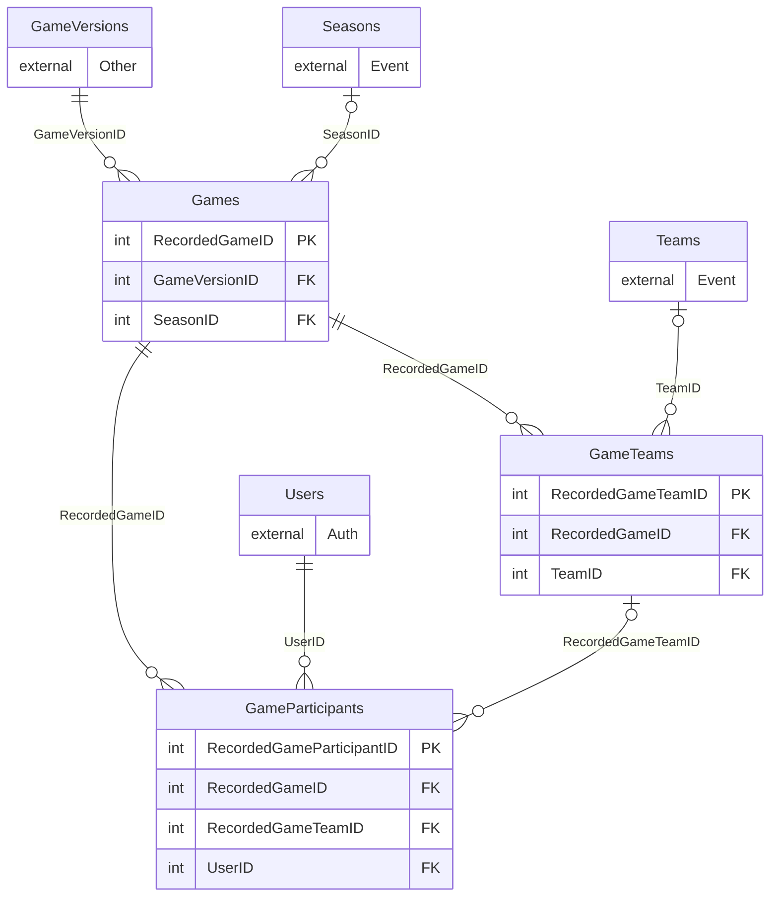
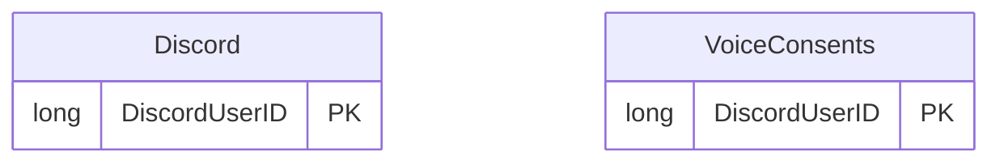
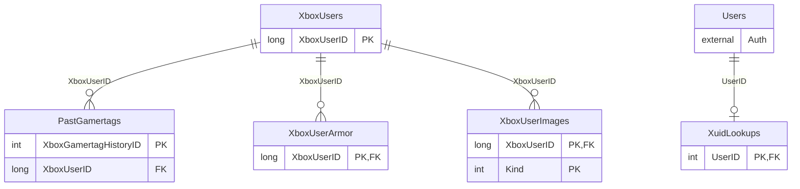

# Database

The app runs on SQL Server (the default), PostgreSQL or SQLite, all from one EF Core model: the entities and their
configurations in `GrifballWebApp.Domain`, in `GrifballWebApp.Infrastructure`'s `GrifballContext`.

## Tables

The tables by schema, with each table's primary and foreign keys. Other columns are left out, and so are the
audit columns (`CreatedByID`, `ModifiedByID`) that most tables have to `Auth.Users`. A table from another schema
appears with its schema name in place of columns. `||` is a required reference and `|o` an optional one.

The diagrams are generated from the SQL Server model: `TableDiagramsTests` (`GrifballWebApp.Migrations.SqlServer.Test`)
fails when they differ from it. After a model change, run it with `GRIF_UPDATE_DOCS=1` and commit the result.

<!-- tables:begin (generated by TableDiagramsTests: run it with GRIF_UPDATE_DOCS=1) -->

### Auth

Identity (users, roles, claims, logins, tokens), password resets, user merges, the chat's choices and spend, data protection keys (13 tables).



### Discord

Discord messages and the outbox (2 tables).



### Event

Leagues, seasons, teams, matches and brackets, signups and availability, reschedules, VODs, and the historical archive and gamertag claims (28 tables).

```mermaid
erDiagram
    AvailabilityOptions {
        int AvailabilityOptionID PK
    }
    GamertagClaims {
        int GamertagClaimID PK
        int ClaimantUserID FK
        int PlaceholderUserID FK
        int SeasonID FK
        int TeamID FK
        long XboxUserID FK
    }
    HistoricalImportJobs {
        int HistoricalImportJobID PK
    }
    HistoricalImportSettings {
        int HistoricalImportSettingsID PK
    }
    HistoricalSeasonReviews {
        int HistoricalSeasonReviewID PK
        int HistoricalImportJobID FK
    }
    HistoricalSourceSnapshots {
        int HistoricalSourceSnapshotID PK
        string HistoricalSourceID FK
    }
    HistoricalSources {
        string HistoricalSourceID PK
    }
    Leagues {
        int LeagueID PK
    }
    MatchBracketInfo {
        int MatchBracketInfoID PK
        int AwayTeamPreviousMatchBracketInfoID FK
        int HomeTeamPreviousMatchBracketInfoID FK
        int SeasonMatchID FK
    }
    MatchReschedules {
        int MatchRescheduleID PK
        int ApprovedByUserID FK
        int RequestedByUserID FK
        int SeasonMatchID FK
    }
    PlayerChampionships {
        int PlayerChampionshipID PK
        int GameVersionID FK
        int SeasonID FK
        int TeamID FK
        int UserID FK
    }
    PlayerSeasonStats {
        int PlayerSeasonStatID PK
        int GameVersionID FK
        int SeasonID FK
        int TeamID FK
        int UserID FK
    }
    ScheduleRecommendationMatches {
        int ScheduleRecommendationMatchID PK
        int ScheduleRecommendationID FK
    }
    ScheduleRecommendations {
        int ScheduleRecommendationID PK
        int SeasonID FK
    }
    SeasonAvailability {
        int SeasonID PK, FK
        int AvailabilityOptionID PK, FK
    }
    SeasonAwards {
        int SeasonAwardID PK
        int SeasonID FK
        int TeamID FK
        int UserID FK
    }
    SeasonMatches {
        int SeasonMatchID PK
        int AwayTeamID FK
        int HomeTeamID FK
        int SeasonID FK
    }
    SeasonSchedulingRules {
        int SeasonID PK, FK
    }
    SeasonSignups {
        int SeasonSignupID PK
        int SeasonID FK
        int UserID FK
    }
    Seasons {
        int SeasonID PK
        int GameVersionID FK
        int LeagueID FK
    }
    SeriesGames {
        int SeriesGameID PK
        Guid MatchID FK
        int RecordedGameID FK
        int SeasonMatchID FK
    }
    SignupAvailability {
        int SeasonSignupID PK, FK
        int AvailabilityOptionID PK, FK
    }
    StatFlags {
        int StatFlagID PK
        Guid MatchID FK
        int RecordedGameID FK
        int SeasonMatchID FK
    }
    TeamAvailability {
        int TeamID PK, FK
        int AvailabilityOptionID PK, FK
    }
    TeamPlayers {
        int TeamPlayerID PK
        int TeamID FK
        int UserID FK
    }
    Teams {
        int TeamID PK
        int CaptainID FK
        int SeasonID FK
    }
    VodTeams {
        int VodID PK, FK
        int TeamID PK, FK
    }
    Vods {
        int VodID PK
        int SeasonID FK
        int SeasonMatchID FK
    }
    GameVersions {
        external Other
    }
    Games {
        external Recorded
    }
    Matches {
        external Infinite
    }
    Users {
        external Auth
    }
    XboxUsers {
        external Xbox
    }
    AvailabilityOptions ||--o{ SeasonAvailability : "AvailabilityOptionID"
    AvailabilityOptions ||--o{ SignupAvailability : "AvailabilityOptionID"
    AvailabilityOptions ||--o{ TeamAvailability : "AvailabilityOptionID"
    GameVersions |o--o{ PlayerChampionships : "GameVersionID"
    GameVersions |o--o{ Seasons : "GameVersionID"
    GameVersions ||--o{ PlayerSeasonStats : "GameVersionID"
    Games |o--o{ StatFlags : "RecordedGameID"
    Games |o--o| SeriesGames : "RecordedGameID"
    HistoricalImportJobs ||--o{ HistoricalSeasonReviews : "HistoricalImportJobID"
    HistoricalSources ||--o{ HistoricalSourceSnapshots : "HistoricalSourceID"
    Leagues ||--o{ Seasons : "LeagueID"
    MatchBracketInfo |o--o{ MatchBracketInfo : "AwayTeamPreviousMatchBracketInfoID"
    MatchBracketInfo |o--o{ MatchBracketInfo : "HomeTeamPreviousMatchBracketInfoID"
    Matches |o--o{ StatFlags : "MatchID"
    Matches |o--o| SeriesGames : "MatchID"
    ScheduleRecommendations ||--o{ ScheduleRecommendationMatches : "ScheduleRecommendationID"
    SeasonMatches |o--o{ StatFlags : "SeasonMatchID"
    SeasonMatches |o--o{ Vods : "SeasonMatchID"
    SeasonMatches ||--o{ MatchReschedules : "SeasonMatchID"
    SeasonMatches ||--o{ SeriesGames : "SeasonMatchID"
    SeasonMatches ||--o| MatchBracketInfo : "SeasonMatchID"
    SeasonSignups ||--o{ SignupAvailability : "SeasonSignupID"
    Seasons |o--o{ GamertagClaims : "SeasonID"
    Seasons |o--o{ Vods : "SeasonID"
    Seasons ||--o{ PlayerChampionships : "SeasonID"
    Seasons ||--o{ PlayerSeasonStats : "SeasonID"
    Seasons ||--o{ ScheduleRecommendations : "SeasonID"
    Seasons ||--o{ SeasonAvailability : "SeasonID"
    Seasons ||--o{ SeasonAwards : "SeasonID"
    Seasons ||--o{ SeasonMatches : "SeasonID"
    Seasons ||--o{ SeasonSignups : "SeasonID"
    Seasons ||--o{ Teams : "SeasonID"
    Seasons ||--o| SeasonSchedulingRules : "SeasonID"
    TeamPlayers |o--o| Teams : "CaptainID"
    Teams |o--o{ GamertagClaims : "TeamID"
    Teams |o--o{ PlayerSeasonStats : "TeamID"
    Teams |o--o{ SeasonAwards : "TeamID"
    Teams |o--o{ SeasonMatches : "AwayTeamID"
    Teams |o--o{ SeasonMatches : "HomeTeamID"
    Teams ||--o{ PlayerChampionships : "TeamID"
    Teams ||--o{ TeamAvailability : "TeamID"
    Teams ||--o{ TeamPlayers : "TeamID"
    Teams ||--o{ VodTeams : "TeamID"
    Users |o--o{ GamertagClaims : "ClaimantUserID"
    Users |o--o{ GamertagClaims : "PlaceholderUserID"
    Users |o--o{ MatchReschedules : "ApprovedByUserID"
    Users |o--o{ SeasonAwards : "UserID"
    Users ||--o{ MatchReschedules : "RequestedByUserID"
    Users ||--o{ PlayerChampionships : "UserID"
    Users ||--o{ PlayerSeasonStats : "UserID"
    Users ||--o{ SeasonSignups : "UserID"
    Users ||--o{ TeamPlayers : "UserID"
    Vods ||--o{ VodTeams : "VodID"
    XboxUsers |o--o{ GamertagClaims : "XboxUserID"
```



### Infinite

Halo Infinite matches, participants and medals (7 tables).



### Matchmaking

Late League: the queue, matched matches, votes and ladder (10 tables).



### Other

Game versions, regions and user experiences (3 tables).



### Recorded

Recorded games, their teams and participants (3 tables).



### User

Discord users and voice consents (2 tables).



### Xbox

Xbox users, past gamertags, XUID lookups, images and equipped armor (5 tables).



<!-- tables:end -->

## Providers

`Database:Provider` picks the database (`SqlServer`, `Postgres` or `Sqlite`), and `ConnectionStrings:GrifballWebApp`
is in that database's own format. For Postgres, in user secrets:
```json
{
  "Database:Provider": "Postgres",
  "ConnectionStrings:GrifballWebApp": "Host=localhost;Port=5432;Database=GrifballWebApp;Username=postgres;Password=..."
}
```

SQLite is for a single instance (`"Database:Provider": "Sqlite"`, `"ConnectionStrings:GrifballWebApp": "Data Source=grif.db"`):
see [sqlite.md](sqlite.md) for what it does and doesn't do.

SQL Server and Postgres behave alike: every DateTime is UTC (read back with Kind Utc, Local refused), and
text compares case-insensitively and accent-sensitively on both ("Noah" = "noah"; on Postgres an ICU collation
mirrors SQL Server's default). Postgres keeps times to the microsecond, SQL Server to 100ns. The tests run on SQL Server unless `GRIF_TEST_DATABASE=Postgres` (or `Sqlite`); CI runs them on all three.

A gap between the providers (something one translates differently) is fixed in the Infrastructure's database layer,
never by rewriting the query that hit it.

## Migrations

Each database has its own migrations project: `GrifballWebApp.Migrations.SqlServer`, `GrifballWebApp.Migrations.Postgres`
and `GrifballWebApp.Migrations.Sqlite`. A model change needs a migration in each (a test fails for whichever is
missing). Each project is its own startup project and reads the connection string from `GrifballWebApp.Infrastructure`'s
user secrets or `ConnectionStrings__GrifballWebApp`; `migrations add` needs none that works, so any placeholder will do
there:
```sh
dotnet ef migrations add <Name> --project GrifballWebApp.Migrations.SqlServer --startup-project GrifballWebApp.Migrations.SqlServer
dotnet ef migrations add <Name> --project GrifballWebApp.Migrations.Postgres --startup-project GrifballWebApp.Migrations.Postgres
ConnectionStrings__GrifballWebApp="Data Source=design.db" dotnet ef migrations add <Name> --project GrifballWebApp.Migrations.Sqlite --startup-project GrifballWebApp.Migrations.Sqlite
```
`dotnet ef database update`, `migrations remove` and `migrations script` take the same `--project` and
`--startup-project`.

Never edit, delete, rename or regenerate a migration that is already on master (its `.cs` or `.Designer.cs`; the
`GrifballContextModelSnapshot.cs` files are expected to change): databases apply a migration's ID once and never again.
Add a new migration instead. The "Master migrations unchanged" check (`.github/workflows/migrations.yml`) fails any PR
that does. A PR's own new migrations can be regenerated freely: its preview resets its database when they no longer
match ([the chart's README](../charts/grifballwebapp/README.md), "Preview reset").

## Row history
Every table keeps the history of its rows except the background jobs' bookkeeping, whose rows churn and whose history
would only grow:

| Table | Why it has no history |
| --- | --- |
| `Auth.ChatMonths` | Each user's spend on the chat's paid models a month: every paid reply adds to its row |
| `Discord.Outbox` | Each message is written a few times, then deleted after its retention |
| `Event.HistoricalImportJobs` | A running import rewrites its row every few seconds |
| `Event.HistoricalSeasonReviews` | Its job's: deleted with the job after its retention |
| `Event.HistoricalSources` | Every refresh stamps each source's last fetch |
| `Event.HistoricalSourceSnapshots` | Whole downloaded files |
| `Xbox.XuidLookups` | The XUID lookup's retry queue (the claims it makes keep their history) |
| `Xbox.XboxUserImages` | The gamer pictures and emblems the image jobs keep: whole images, rewritten when one changes |
| `Xbox.XboxUserArmor` | What each account has equipped in Halo Infinite, rewritten on every change |
| `Xbox.UserSpartanRenders` | Whether a user's Spartan render is asked for, running, done or failed; bookkeeping the render job rewrites |
| `Xbox.UserSpartanFiles` | The six rendered files (models and pictures) of a user's Spartan, replaced whole by each render |

A test (`EveryTable_KeepsHistory_ButTheBackgroundJobsBookkeeping`) fails for any other table without history. This section is about SQL Server and Postgres; SQLite keeps the same history with a few
differences ([sqlite.md](sqlite.md)).

Both databases keep every version of every row in the same place: for each table
`"Schema"."Table"`, the versions a row had before an update or delete are in `"Schema"."TableHistory"`, each with
`PeriodStart` and `PeriodEnd`, the UTC times it was current. The table's own `PeriodStart` is when the row got the
values it has now, and its `PeriodEnd` is always the end of time, `DateTime.MaxValue` (SQL Server's
`9999-12-31 23:59:59.9999999`, Postgres's `infinity`). SQL Server does this with temporal tables. Postgres has none, so triggers do it
(`GrifballWebApp.Infrastructure/PostgresHistory.cs`, functions in `PostgresHistoryFunctions.cs`): every `UPDATE`,
`DELETE` (cascades included) and `TRUNCATE` copies the rows it replaces into the history table, one `INSERT` a
statement. Each table has its own versioning function, `"Schema"."Table_versioning"`, written for it by
`grif_refresh_versioning`: plain SQL naming its history table and their columns, which Postgres parses once a session
rather than building the SQL from the catalog on every write. The time is the
transaction's start, so the changes of one transaction share it. The app's login can read the history but not
change it. Nothing deletes old history: the tables grow with every change.

Rows a table already has when it becomes temporal have been current since the beginning of time: their `PeriodStart`
is `DateTime.MinValue` (SQL Server's `0001-01-01`, Postgres's `-infinity`), so `TemporalAsOf` a time before then
finds them as they are now, and their first change keeps that version from `DateTime.MinValue`. On Postgres that
includes the rows every table had when `AddRowHistory` added history to them. Rows written after get the
transaction's time.

On Postgres the history tables are in the EF model, generated from their tables, so `migrations add` changes both
together, with no hand edits: a column added to a table is added to its history table too (nullable there), a
renamed column is renamed in both (`RenameColumn` twice), and a new table gets a history table and its triggers (the
migration calls `grif_enable_versioning`, added by the Postgres project's `HistoryMigrationsModelDiffer`). An existing table
made temporal gets them the same way, and the differ scaffolds its `PeriodStart` as added with the default
`'-infinity'`, for the rows it has, then altered to the model's default, `transaction_timestamp()`: both change only
the catalog, rewriting no rows. A table renamed or moved to another schema takes its history table with it
(`RenameTable` and `RenameIndex` for both, as SQL Server alters its `HISTORY_TABLE`), keeping the history and the
triggers, which are on the tables.

As the versioning function names the tables and columns, a migration that renames or moves a table with history, or
adds, drops or renames a column of one, writes it again once those are done: the differ scaffolds
`CALL public.grif_refresh_versioning('"Schema"."Table"')` after them (and `grif_disable_versioning`, which drops the
function, before a history table is dropped). A change to such a table made with hand-written SQL in a migration
(`migrationBuilder.Sql`) needs that call too, or the next `UPDATE` or `DELETE` of the table fails (a renamed or
dropped column) or leaves a new column out of the history. A column's type can change without it.

Besides its index on the key and `PeriodEnd` (a row's versions, and the one current at a time), a history table has
one on each foreign key's columns and `PeriodEnd`, like the table's own foreign key indexes, so `TemporalAsOf` with
`Include` or a navigation finds the related rows' versions by index, not by reading the whole history table. They
come from the model too: a foreign key added to a table gets its history table's index in the same migration.

The triggers' functions are scaffolded too, from `PostgresHistoryFunctions.cs`: the migration that gives the first
table history creates them, and one that takes away the last drops them. They are versioned: the model records the
version (`Grif:HistoryFunctions`, in the snapshot), so to change a function, add a version there with the whole of
its SQL, and `migrations add` scaffolds a migration that creates it over the old one (its `Down` puts the old one
back); `has-pending-model-changes` reports the new version until then. Keep the old versions: those migrations need
them. A version that changes a function's signature or drops one must drop the old one first itself, as `CREATE OR
REPLACE` can't, and one that changes what `grif_refresh_versioning` writes must call it for each table with history
(and its `Down`'s version again).

One change loses data, on both databases (EF's doing, not the history's): renaming an entity class and its table in
the same migration. EF can't tell that is the same table, so it scaffolds `DropTable` and `CreateTable` (and warns
that the operation may result in the loss of data): the table's rows go, and its history with them. Rename the class
first (an empty migration), then the table in a second one: both keep the rows and the history.

In code, query the history with EF's temporal queries, the same code on both databases:
```csharp
var then = await context.Seasons.TemporalAsOf(time).Include(s => s.SeasonMatches).SingleAsync(s => s.SeasonID == id);
var versions = await context.Seasons.TemporalAll()
    .Where(s => s.SeasonID == id)
    .OrderBy(s => EF.Property<DateTime>(s, "PeriodStart"))
    .Select(s => new { s.SeasonName, From = EF.Property<DateTime>(s, "PeriodStart"), To = EF.Property<DateTime>(s, "PeriodEnd") })
    .ToListAsync();
// Also TemporalFromTo(a, b), TemporalBetween(a, b) and TemporalContainedIn(a, b).
```
SQL Server translates them to `FOR SYSTEM_TIME`. On Postgres `UseGrifballDatabase` adds a translator
(`GrifballWebApp.Infrastructure/PostgresTemporalQueries.cs`) that reads the table and its history table with SQL Server's
rules, so they return the same rows: `AS OF` carries to `Include`s and navigations, other operations refuse them, and
versions that lasted no time (a row changed twice in one transaction) are left out, as `FOR SYSTEM_TIME` does. Their
times are query parameters on Postgres, so EF compiles a temporal query once and caches it whatever its times (SQL
Server's `FOR SYSTEM_TIME` has the time in its SQL, so there each time is a query of its own; in `EF.CompileQuery`,
on both, the time is fixed when the query is compiled). Times
are UTC (`Kind` `Local` is refused on Postgres; SQL Server would read its local clock time as UTC). Postgres
keeps microseconds, so a time between two is rounded the way that gives each comparison SQL Server's answer.

By hand in psql, a row's old versions, and the row as it was at a time:
```sql
SELECT * FROM "Event"."SeasonsHistory" WHERE "SeasonID" = 1 ORDER BY "PeriodEnd";

SELECT * FROM (
  SELECT "SeasonID", "SeasonName", "PeriodStart", "PeriodEnd" FROM "Event"."Seasons"
  UNION ALL
  SELECT "SeasonID", "SeasonName", "PeriodStart", "PeriodEnd" FROM "Event"."SeasonsHistory"
) v WHERE "SeasonID" = 1 AND "PeriodStart" <= '2026-10-01 12:00+00' AND "PeriodEnd" > '2026-10-01 12:00+00';
```

## Converting between SQL Server and PostgreSQL
`GrifballWebApp.Convert` copies a database into a new one on either server, or the same kind:
```sh
dotnet run --project GrifballWebApp.Convert -- \
  --Source:Provider=SqlServer --Source:ConnectionString="Server=...;Database=GrifballWebApp;..." \
  --Target:Provider=Postgres --Target:ConnectionString="Host=...;Database=GrifballWebApp;..."
```
(or `Source__Provider` and the rest in the environment; the target defaults to the app's own `Database:Provider` and
`ConnectionStrings:GrifballWebApp`). The backend image has it at `/app/convert`, and the Helm chart runs it on a first
deploy with `migrations.convert`.

- **The target** must be new: missing, or without tables. It's created with this build's migrations, so it has the
  schema the app expects on its server: the collation, row history's triggers (Postgres) or system versioning (SQL
  Server), the same keys and indexes.
- **The source** is only read. It must have exactly this build's migrations, so both have the same tables and
  columns. On Postgres it's read in one snapshot, and on SQL Server too if the database allows snapshot isolation;
  otherwise nothing should write to it during the copy.
- **Every row** of every table is copied in one transaction, keys as they are; identity columns carry on after the
  highest. Rows go in parents first. Where two tables refer to each other (a team and its captain, a match and its
  active reschedule request), the nullable side is set once both are in; a table's references to itself (a bracket's
  previous matches) are met by the order of its rows.
- **Row history** comes too, each version with its times: Postgres's triggers are off while its history tables load,
  and SQL Server's period columns, which take no values, are made plain columns for the load and its period and
  system versioning put back after, checking the history against the current rows.
- **Values** go across as what both hold: times UTC and to the microsecond (Postgres's precision), the end of time
  (SQL Server's 9999-12-31, Postgres's `infinity`) and the beginning (`-infinity`) as each other, `datetimeoffset`
  as the same instant.
- **Before it commits**, every table is read back from the target and compared with what was read from the source
  (the row count and a hash of every row's values, to the microsecond); any difference fails the conversion. If
  anything fails, the target is put back: dropped when the conversion created it, or, if it was there already (an
  empty database made beforehand), its migrations undone, so it has no tables again.

